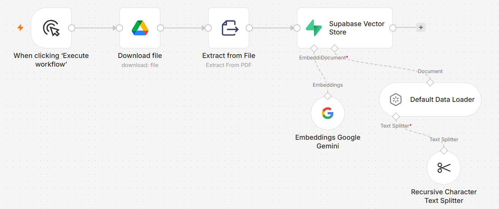
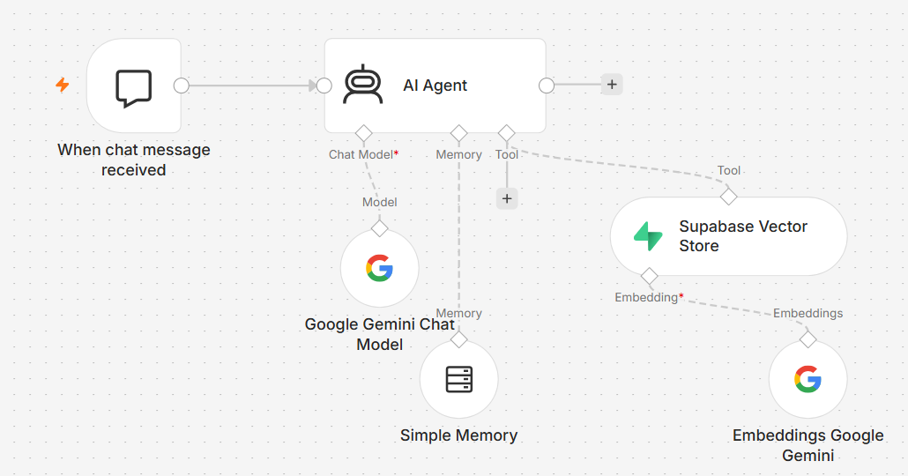
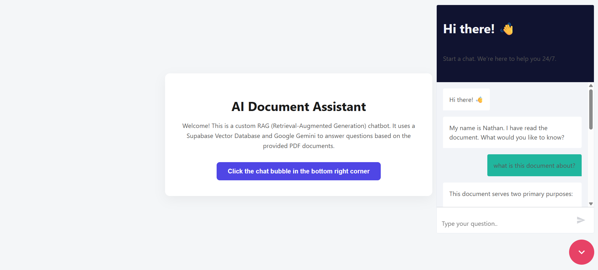

# Advanced RAG Chatbot with n8n, Supabase, and Google Gemini

This project is a fully functional Retrieval-Augmented Generation (RAG) chatbot built with n8n. It ingests custom documents, stores their embeddings in a vector database, and uses an AI Agent with memory to answer user questions via an embedded website chat widget.

## Architecture

The system is divided into two automated workflows:

### 1. Document Ingestion Pipeline
- **Trigger:** Manual execution (or can be adapted to a Google Drive trigger).
- **Processing:** Downloads a PDF file and extracts the text.
- **Chunking:** Uses a Recursive Character Text Splitter to break the text into manageable chunks with overlap.
- **Embeddings:** Generates embeddings using Google Gemini.
- **Storage:** Uploads the vectorized text chunks to a Supabase Vector Store.

### 2. Chat Agent Interface
- **Trigger:** Webhook (n8n Embedded Chat Widget).
- **LLM:** Google Gemini Chat Model.
- **Memory:** Window Buffer Memory node for conversational context.
- **Tool:** Supabase Vector Store tool configured to retrieve accurate document chunks based on the user's query.
- **Output:** Synthesizes the retrieved data and sends the generated response back to the website widget.

### 3. Frontend Interface
A clean, responsive HTML page hosting the n8n chat widget. It is designed to adapt to mobile screens, ensuring the chat input remains visible and accessible.

## Technology Stack
- **n8n:** Workflow automation and LangChain AI Agent orchestration.
- **Supabase:** PostgreSQL database with pgvector for vector storage and similarity search.
- **Google Gemini API:** Used for both the Chat Model and Text Embeddings.
- **HTML/CSS/JavaScript:** For the frontend chat widget deployment.

## How to Deploy and Test

1. **Import Workflows:** Import the `Ingestion.json` and `Chat.json` files into your n8n instance.
2. **Configure Credentials:** You will need to add your own credentials for:
   - Google Gemini (PaLM) API
   - Supabase API (with the `documents` table and vector extension enabled)
   - Google Drive (if using the download node)
3. **Ingest Data:** Run the Ingestion workflow to populate your Supabase vector database.
4. **Host the Frontend:** Host the provided `index.html` file on any static web hosting service (such as GitHub Pages, Vercel, or Netlify).
5. **Update Webhook:** Open `index.html` and replace the `webhookUrl` with your specific n8n Chat Trigger production URL.
6. **Publish:** Ensure both workflows are published and active in n8n. Open the website to chat with your documents.